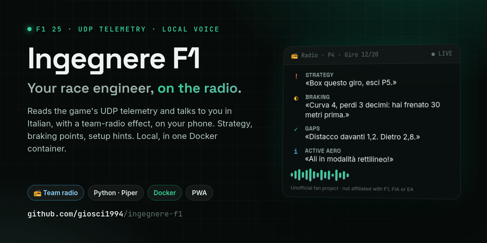

# 🎧 Ingegnere F1

**A home-made race engineer for EA SPORTS F1 25 (2026 Season Pack): it listens to the game's UDP
telemetry, decides what is worth saying, and says it in Italian, with a team-radio effect, on a
small web app for your phone. Everything runs locally in one Docker container.**

### 🌐 Landing page: [`docs/index.html`](docs/index.html) (on GitHub Pages when the repository goes public)

<p align="center">
  <a href="https://github.com/giosci1994/ingegnere-f1/actions/workflows/build.yml"></a>
  
  
  
  
  <a href="LICENSE"></a>
  <a href="https://buymeacoffee.com/giosci1994u"></a>
</p>

<p align="center">
  
</p>

> **Unofficial fan project.** Ingegnere F1 is not affiliated with, endorsed or sponsored by
> Formula 1, the FIA, Electronic Arts or Codemasters. "F1", "Formula 1", "FIA" and "EA SPORTS"
> are trademarks of their respective owners and are used here only to describe compatibility.
> No logos, fonts, images or audio from the game or the championship are used.

> **Note:** the app's interface and the radio are in Italian. Labels quoted below are the ones you
> will see on screen, with an English translation in brackets.

## Contents

- [Features](#-features)
- [Requirements](#-requirements)
- [Install](#-install)
- [Usage](#-usage)
- [Privacy](#-privacy)
- [Development](#-development)
- [Credits and third-party software](#-credits-and-third-party-software)
- [Support](#-support)
- [License](#-license)

## ✨ Features

- **Telemetry**: UDP packet format **2026** (24 cars, Car Telemetry 2 with active aero and
  Overtake Mode) and **2025** as a fallback.
- **Live calls**, each group can be switched on/off from the page: flags and wrong way, safety car
  and VSC, box window and pit limiter, penalties and track limits, tyres (wear, temperatures,
  blistering), fuel, battery and Overtake, damage, weather, gaps ahead/behind, positions, laps to
  go, lap times and records, **strategy** (undercut/overcut, where you rejoin after a stop, pit
  loss measured per track), **braking and corner exits** compared with your best lap (one short
  call on the next straight that says *how* to improve: brake later, carry more speed, throttle
  earlier…), **2026 active aero** reminders. Corners are called by their **official numbers**
  on the tracks of the 2026 calendar; in practice the engineer can work on **one corner at a
  time**; on a qualifying flying lap there is **radio silence** except urgent calls.
- **Ask the engineer** with a button: assign a button to *UDP Action 1–12* in the game's
  controls and pick the question in the page (strategy, tyres, gaps, fuel, damage, pace,
  repeat).
- **Pronunciation dictionary** for names and English terms, editable from the page with a
  «Prova» (try) button.
- **Responsive page**: phone (portrait and landscape), tablet and PC, with more columns on wide
  screens.
- **A real radio**: one phrase at a time, priorities (safety > box/penalties >
  tyres/fuel/damage/weather > gaps/positions > the rest), no overlaps, cooldowns, three verbosity
  levels. Local voice ([Piper](https://github.com/OHF-Voice/piper1-gpl)) with beeps, band-pass,
  saturation, hiss and squelch generated in code.
- **After the session**: laps, pace, best sectors and ideal lap, stops and stints, errors;
  per-corner losses and causes; **setup reading with indicative suggestions**, each backed by the
  data point behind it; active aero usage.
- **Racing line**: every lap of the player is stored as a compact trace; the **«Traiettoria»**
  (racing line) tab overlays any two laps of a track (also from different sessions or drivers)
  with per-corner braking point, minimum speed and throttle point.
- **Recorder and player**: real sessions are saved and can be replayed over UDP; a **simulator**
  generates a full fake race that triggers every rule, for testing without the game.

## ✅ Requirements

- **EA SPORTS F1 25** with the 2026 Season Pack. Built for the PS5; other platforms that send the
  same UDP telemetry have not been tested.
- A small always-on computer on the same network with **Docker** and Docker Compose, **amd64**
  (an Intel N150-class mini PC is enough: the container uses about 200 MB of RAM).
- A phone (Android or iPhone) with a recent browser, on the same network.
- About 90 MB for the two Italian Piper voices (downloaded separately, see below).

## 📦 Install

```bash
git clone https://github.com/giosci1994/ingegnere-f1.git
cd ingegnere-f1
# 1. voices (not in the repository): put these four files in ./voci
#    https://huggingface.co/rhasspy/piper-voices/tree/main/it/it_IT/riccardo/x_low
#      it_IT-riccardo-x_low.onnx, it_IT-riccardo-x_low.onnx.json
#    https://huggingface.co/rhasspy/piper-voices/tree/main/it/it_IT/paola/medium
#      it_IT-paola-medium.onnx, it_IT-paola-medium.onnx.json
# 2. optional: your time zone
echo "TZ=Europe/Rome" > .env
docker compose up -d --build
```

- UDP **20777**: game telemetry. TCP **8777**: the web app (`http://<server-ip>:8777`).
- Data (recordings, lap library, summaries, settings, voice cache) lives in `./dati`.

## 📖 Usage

1. **In the game** (Settings → Telemetry): UDP on, broadcast off, the IP address of the server,
   port 20777, send rate 20 Hz, **UDP format 2026**.
2. **On the phone**: open `http://<server-ip>:8777`, tap **«Collega la radio»** (Connect the
   radio) once — iOS only plays audio after a tap — and keep the page in the foreground. Without
   HTTPS the Screen Wake Lock API is not available, so a muted looping video keeps the screen on.
3. Drive. In **«Avvisi»** (Calls) switch groups of calls on or off and set verbosity, volume,
   voice and speed, the pronunciation dictionary and the questions for the UDP Action buttons
   (in the game, assign a button to *UDP Action N* in the controls menu — check where exactly
   in your version of the game); the settings are shared by every phone connected.
4. After the session, **«Riassunti»** (Summaries) has laps, sectors, stops, errors and setup
   suggestions; **«Traiettoria»** (Racing line) compares two laps.

## 🔐 Privacy

- **Everything stays on your network**: no cloud services, no accounts, no analytics. The voice
  is synthesized locally; no cloned voices, no broadcast audio.
- `onnxruntime` (used by Piper) sends usage telemetry unless disabled: the image sets
  `ORT_DISABLE_TELEMETRY=1` and the code calls `disable_telemetry_events()`.
- **There is no login**: the web app is meant for the home network. Do not expose ports 8777 or
  20777 to the internet.
- Recordings and lap traces contain only game telemetry and the driver names shown in the game;
  they are stored in `./dati` and never leave the server.

## 💻 Development

**GitHub Actions** builds the Docker image (amd64) and runs the offline tests on every push and
pull request → [`.github/workflows/build.yml`](.github/workflows/build.yml). No voices and no
`dati/` are needed: the tests use races generated by the simulator.

Test without the game, on a running install:

```bash
docker exec ingegnere-f1 python -m ingegnere.simulatore --uscita /dati/registrazioni/fake.f1rec.gz
docker run --rm --network host -v $PWD/prove:/prove ingegnere-f1:locale python /prove/ascolta.py --secondi 300 &
docker exec ingegnere-f1 python -m ingegnere.riproduci /dati/registrazioni/fake.f1rec.gz --velocita 2
```

Offline (standard library only, from `app/`):

```bash
cd app
python3 ../prove/prova_pacchetti.py
python3 -m ingegnere.simulatore --uscita /tmp/race.f1rec.gz
python3 ../prove/prova_offline.py /tmp/race.f1rec.gz --quieto
```

Page check in a real Firefox: `python3 prove/pagina.py` (needs geckodriver).

Fake laps go into the same per-track library as real ones (the simulator uses track id 11): clear
`dati/giri/11` and `dati/piste.json` after testing on a real install.

### Project structure

```
app/ingegnere/   decoding, state, rules, radio, voice, phase 2 analysis, server, tools
web/             the phone web app (Italian UI), manifest and icons
prove/           tests: packets, offline race, fake phone, real Firefox
strumenti/       icon generator
docs/            landing page and social preview
```

Notes for coding agents are in [`AGENTS.md`](AGENTS.md). Code, comments and UI are in Italian.

- Packet structures follow EA's official *F1 25 2026 Season Pack UDP specification*, as shipped
  in `data/spec.h` of the open-source [`f1-packets`](https://pypi.org/project/f1-packets/)
  2026.1.1 package; the 2025 sizes match the official F1 25 specification.
- Setup suggestions are rules of thumb, not truth: the telemetry has no inner/outer tyre edge
  temperatures and no kerb data, so there are no suspension or ride-height suggestions.

## 🙏 Credits and third-party software

| Component | Used for | License |
|---|---|---|
| [`f1-packets`](https://github.com/P403n1x87/f1-packets) | reference for the UDP packet structures (not a dependency) | MIT |
| [Piper](https://github.com/OHF-Voice/piper1-gpl) (`piper-tts` 1.8) | local text-to-speech, installed in the image | GPL-3.0-or-later |
| [onnxruntime](https://github.com/microsoft/onnxruntime) | runs the Piper voice models | MIT |
| [aiohttp](https://github.com/aio-libs/aiohttp) | web server and WebSocket | Apache-2.0 |
| [NumPy](https://numpy.org) | radio effect | BSD-3-Clause |
| [MultiViewer](https://multiviewer.app) circuit API | positions of the official corner numbers (`numeri_curve.py`, data from F1 live timing), downloaded once | data, credited |
| [Piper voices](https://huggingface.co/rhasspy/piper-voices): `it_IT-riccardo-x_low` | the male voice (downloaded separately) | voice repository: MIT · trained on the [M-AILABS Speech Dataset](https://www.caito.de/2019/01/03/the-m-ailabs-speech-dataset/) (BSD-style license by M-AILABS) |
| [Piper voices](https://huggingface.co/rhasspy/piper-voices): `it_IT-paola-medium` | the female voice (downloaded separately) | voice repository: MIT · dataset [OHF-Voice/voice-datasets](https://github.com/OHF-Voice/voice-datasets) (CC0), fine-tuned from a base model trained on [Hi-Fi TTS](https://www.openslr.org/109/) (CC BY 4.0) |

The source code in this repository is licensed under the GNU AGPL-3.0: you can use, modify and
share it for free, but if you distribute a modified version, or run it as a service over a network,
you must publish your source code under the same license and keep the copyright notice.
The Docker image you build also contains `piper-tts`, which is GPL-3.0-or-later (compatible with
the AGPL): if you redistribute the built image, the GPL terms apply to it.

## ☕ Support

If this project is useful to you, you can support its development:
**[buymeacoffee.com/giosci1994u](https://buymeacoffee.com/giosci1994u)** ☕

## 📄 License

[AGPL-3.0](LICENSE) © 2026 giosci1994. Third-party components keep their own licenses (see
[Credits](#-credits-and-third-party-software)).
